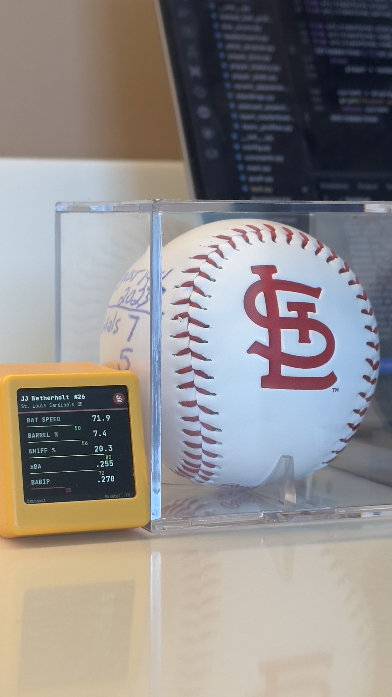
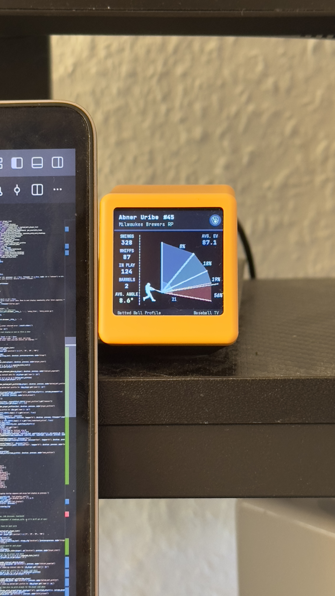
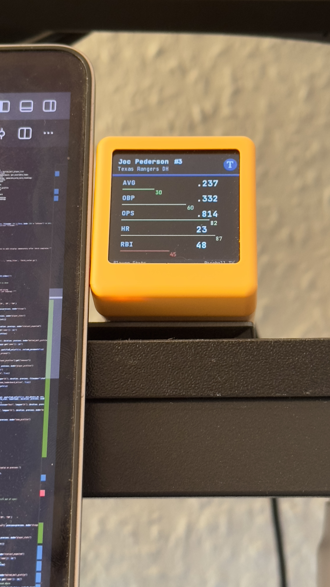
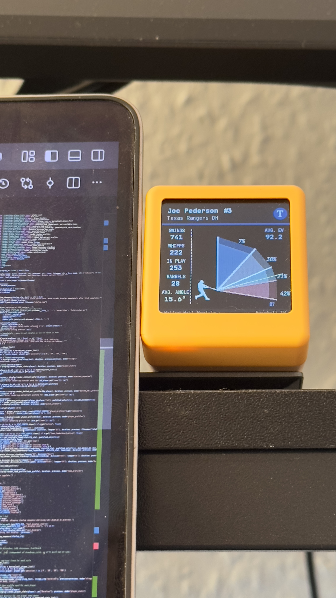
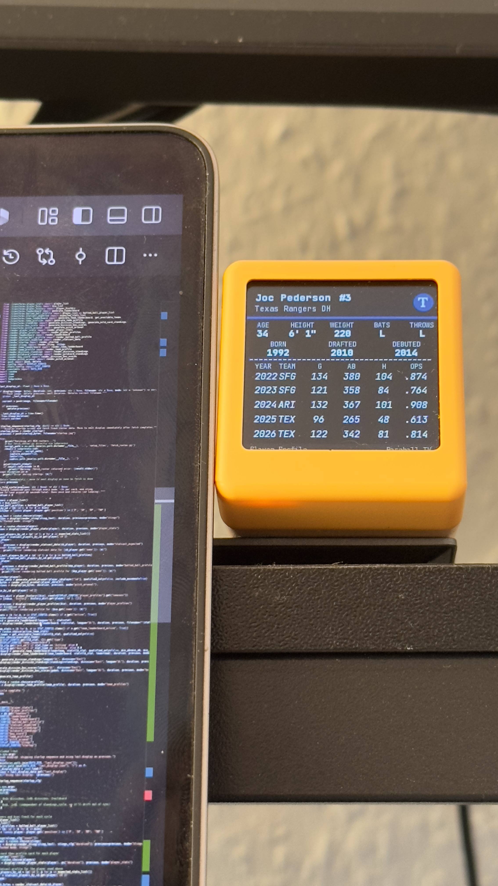
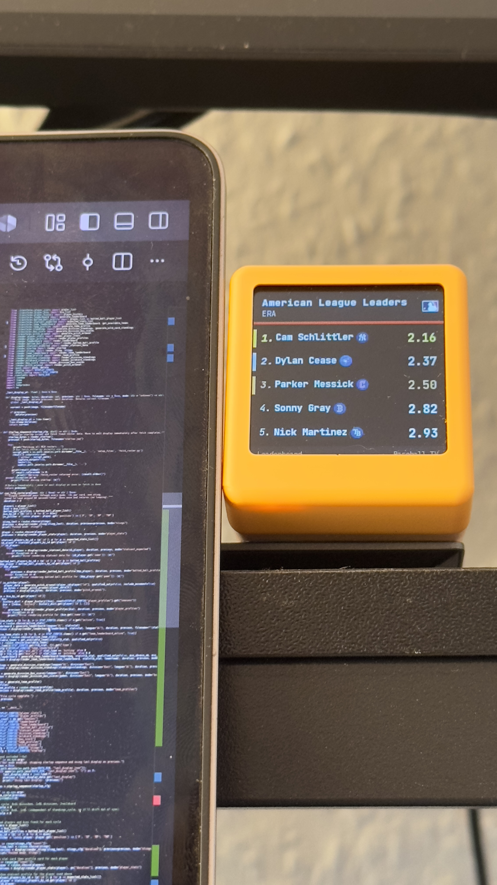
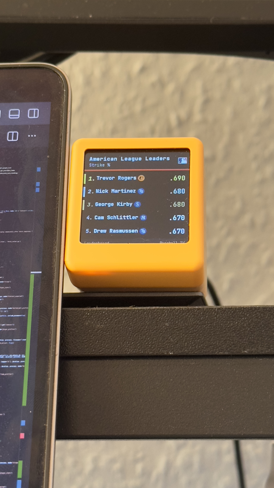
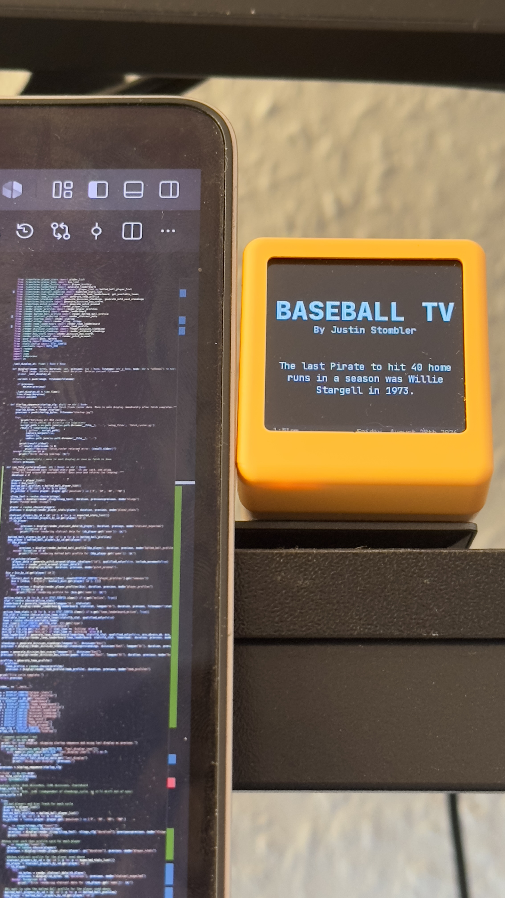
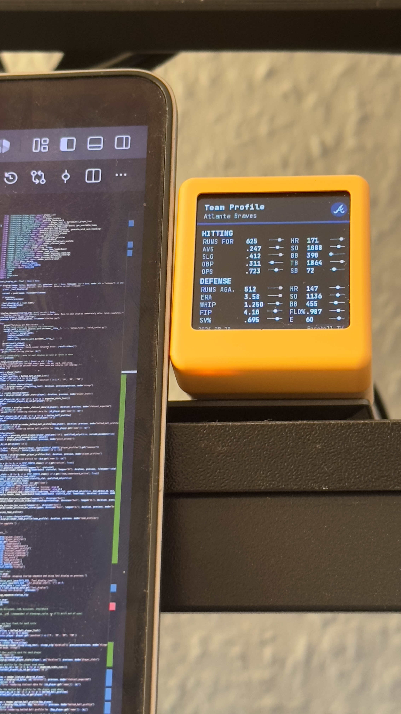

## Baseball-TV

The World's Smallest Scouting Report

Hi! I'm Justin, and I have been building this little Baseball TV as a personal project to both whet my ravenous appetite for baseball knowledge and show off my skills in repository and dataset setup and design. Back in 2020, I began learning Python and SQL during lockdown using baseball data as my main catalyst, and it quickly became an obsession. I pushed myself both technically and creatively, keeping a blog to this day at www.sevenyardsback.com. I was extremely fortunate to have these efforts pay off, as I began landing my first analyst roles. As I move onto the next chapter of my professional career and look to advance my skillset even further, this felt like a fantastic next opportunity.

Nothing here is written by AI. Is that a pro? Is that a con? I'm not yet sure but at least you know.

#### *Introduction*

Rotating Baseball Stat Visualization Host, currently optimized for 240x240 screens.

Photos upload to screen's device via API and delete themselves upon upload of the next round, order is controlled in main.py.

In general, this project has been put together for three reasons:

1) I love baseball and data, and this seemed like a tremendously fun way to combine the two. I spent my youth pouring over the league's media guides number by number and have in my adulthood turned to using these same numbers as a creative outlet.
2) Baseball and data have continued to be a very powerful learning tool for me, and I wanted to build this repository to show off the things I have learned in my professional career in data, as I seek similar roles in the future.
3) I genuinely think this is a cool idea, and I would've kicked myself if I hadn't tried it.

#### *Workflow and Design*

While this pipeline does not output into a source system, so to say, this is still very much written with my knowledge of both ETL and DataVault concepts in mind.

There are 3 distinct layers at play here.

1. The 'raw' layer. This raw data is called via both the statsapi library wrapper for the MLB's official API and the pybaseball library for Baseball Savant metrics. Here, data is returned in a JSON structure for information in the current season for any batting, pitching, biographic, roster, or game state information I am interested in.
2. The 'transform' layer. The preceding JSONs are then stripped of data deemed unneccesary for the visualization and/or cleaned as required. These will also pull in from the static data folder to add a player's jersey numbers and team abbreviations, so the render layer can use those dynamically.
3. The 'render' layer. This layer is merely a collection of functions that contain shapes drawn with the Pillow Python Image Library (PIL), combined with dynamically called data from the transform layer as requested. These functions, when called in main.py, populate with data and create the images displayed on the screen one by one using push.py. These are then deleted after being shown, to prevent the device from overflowing (only holds 2MB roughly).

The images themselves and the various details they can show are largely controlled in the config files.

One, the display config file, sets the order of the carousel, including:

- How many seconds a screen should show
- How many times a mode should iterate before moving onto the next
- How to handle playoff games v. regular season box scores

Two, the stat config file, contains a wide variety of information about how stats are meant to be displayed, including:

- Is a stat meant to be sorted ascending or descending? The ERA leaderboard shouldn't be led by someone with an 11.93 ERA.
- Should a specific stat be available for leaderboard creation? Not every stat makes for a compelling leaderboard.
- If a stat is meant to be attributed to a hitter or a pitcher?
- Is the stat aggregated by sum? By rate? This was a hyper-critical step in data assurance.
- The stats to show, and their order, for player stats, Statcast, team profiles, recent appearances, and player bio modes.

The config files are very powerful, and allow me to pick and choose stats and display parameters much more quickly than having to edit the transforms' codes themselves. The hope is that if this were a released product, these files would serve as the basis for a settings menu that a user would have to edit the visualizations on their own Baseball TV.

Lastly, although the data displayed is ordered formulaically, the images themselves are created randomly from the appropriate bucket of players, teams, or stats to allow for an experience where you are never seeing the same thing in the same order. I wanted to mimic the feeling of flipping through channels.

#### *Modes*

As of this writing, the Baseball TV supports 13 various kinds of images. All created dynamically with live data, updating in real-time when the image is created.

1. Traditional Player Stats
2. Statcast Data
3. Batted Ball Profiles
4. Player Biographies
5. Player's Recent Performances
6. Pitch Arsenals (PITCHER ONLY)
7. League Leaderboards
8. Team Leaderboards
9. Division Standings
10. Wildcard Standings
11. Team Profiles
12. Live Box Scores
13. Stings
    1. These are little text blurbs I've added to serve as fun facts/loading screens/mode separators

#### *Baseball Specific Minutiae*

One of the most gratifying parts of this project was that it turned into an attempt to reverse engineer a highly accurate and easily comprehensive baseball database.

As such, a non-exhaustive list of just some of the considerations I've put into this program are below:

- Upon startup, the program always pulls updated rosters, and ensures only players who are on an active MLB roster are able to show up. This does mean players on the IL are not available in the pool, but that was an intentional design choice. This does mean that trades and call-ups are caught in real-time.

  - This was a critical step in ensuring properly managed jersey numbers, as players being called up and down had a tendency to break the jersey number logic.
- Additionally, only players who are actually qualified for league leaderboards are able to show up on the league leaderboards. However, for team-specific leaderboards the Baseball Savant approach was taken, where a pitcher must have 1.25 innings per games played, and a batter 2.1 at bats. This allows the lesser known players on a team (especially relievers) to be able to appear in images.
- I came up with my own suite of pitch abbreviations and color choices for the pitch arsenal screen, which took me back to my days playing MVP Baseball 05.
- There is a file that pulls in the hex colors of each team, and its primary and secondary colors always make an appearance in player-specific screens when the player is on its roster.
- I had to hand-calculate FIP (Fielding Independent Pitching). It's not available via either of the APIs I have used, but I wanted it for the Team Profiles. So I pulled the FanGraphs formula and reverse engineered the 2026 constant to ensure my hand-calculated FIP always matches that reported elsewhere. This isn't the first time I've done this, and honestly it makes me laugh that even in today's day and age, I had to bust out formulas and paper.

  - Below, from the MLB
  - Where the "FIP constant" puts FIP onto the same scale as the entire league's ERA: ((HR x 13) + (3 x (BB + HBP)) - (2 x K)) / IP + FIP constant.
- The player bio screen is a direct homage to the baseball cards of my youth, hence the traditional counting stats and biographical information. It is also designed intentionally to mimic a baseball card.

  - I would like to eventually give information on the 'did not play MLB baseball' row that will populate if a player was injured, in the minors, or in a foreign league, but I believe that to be beyond the scope of the source material I'm pulling from.
- X and Y data for pitch location had to be averaged, but also normalized so I could make sure it fit the image of the to-scale strikezone I created.

  - The original intent was to create accurate physical trails following the balls depicting a pitcher's release point, angle, and spin rates. To no one's surprise, this was well beyond the scope of this project. Any attempt led to far too little visual clarity (even if they admittedly did look cool), and so that was scrapped. On a larger screen or with more time, this would've been doable.
  - Instead, the screen was given a "Pitch Inventory" feeling with 6 available 'slots' that can be marked empty. This is meant to evoke a little "MLB The Show" and perhaps a little Pokemon, depending on what I was going for when I ideated over this screen. The SPD/SPN were meant to be effective ways to show a pitcher's tendencies compared to the rest of the league throwing the same pitch. This was a prime example of a screen that had to be pared back to figure out the right way to display nuanced information without being overwhelming.
- The batted ball profile uses colored cones set to the exact angles for each hit type as described by MLB's statistics glossary. The amount of the cones that are colored in fully with transparency is directly tied to the percentile of average exit velocity of the player's batted balls. In other words, a slugger's cones are going to POP much more than those of someone who is struggling to find the barrel.
- Similarly, the percentile bars in the player stat and Statcast data modes are very useful indicators in the 'language' of the project. The sudden pop of color that accompanies the page of an excellent player is both highly eye-catching and immediately telling once a viewer learns the language of the UI.
- On the other hand, I was tempted to make every percentile color-coded by number (0 red to 100 green), but I felt that added too much noise to the visual. Instead, the length of the bar is the determining factor of how 'good' a player is. The color is merely for pop and is statically defined.
- The list of stings was entirely hand-written, and was meant to model a typical baseball loading screen. While a loading screen is actually not necessary in this loop, I felt it provided a much-needed 'TV-ification' of the process. The inspiration was a mix of video game-y tips and tricks, and the [adult swim] stings so popular on the channel of the same name. Good UI will always be made with personality as part of the nuance.
- For any team stat in a team profile, a blue or gold number suggests that that team is either worst or best in the league at a specific stat. It's a bit of a nod to Baseball Reference's tendency to bold and italicize leaders.
- In the box score view, the winning team's scoreline will always be bolded once a game is final. Any half inning with 3 or more runs scored gets a blue number, while 5 or more gets red. Box scores are a lot, and the screen is small. This helps attract the eye to where in the box score significant moments lay. If a game is ongoing, the current half-inning's score is marked with a *. Additionally, the numbers 1-9 and RHE above the box scores will hide themselves if all games on screen are upcoming. These are listed in chronological order by league, so there will never be a moment when you see 1-9 and RHE directly above the probables for a game yet to take place.
- For league and team leaderboards, the top 3 players in any stat are given a little gold, silver, and bronze coloring. While these colors are very much associated with the Olympics, it felt like a fun way to show off the best of even the top 5 in a way that is functionally understood across all sports.
- Each stat has its own formatting to ensure the data is always presented in a digestible way to anyone who is farmilar with the conventions of traditional baseball record keeping. ERA is always X.XX, while OPS is X.XXX and average is .XXX, as examples.
- The ideas here are really only limited to what I feel I can confidently display. If I can't create a screen that I feel contains nuance and restraint, it likely isn't the right idea. Examples of this have included stadium information, live game information incl. runners, outs, and count, and hot/cold zones per pitch type for a hitter.

#### *See Me Live!*

Using the link below, you can access a YouTube video designed to help you get a sense of both the scale of the project and its functionality.

[youtu.be/U9X71sG-Pi0](https://youtu.be/U9X71sG-Pi0)

#### *Album*

Please note that these pictures do not necessarily reflect final UI development.

